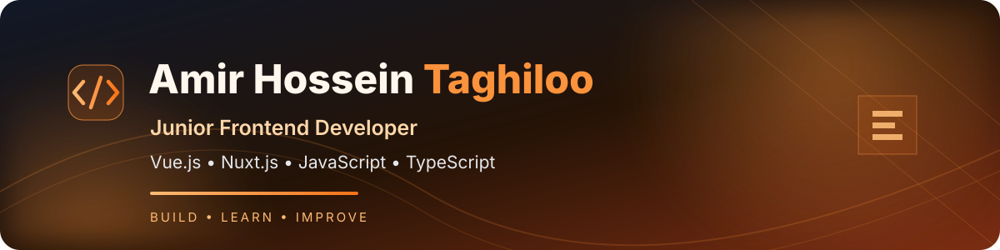

<!-- Profile README | Amir Hossein Taghiloo -->

  
    

  
  

---

## 👋 About Me

I'm **Amir Hossein Taghiloo**, a Computer Engineering student and **Junior Frontend Developer** focused on building modern web applications with **Vue.js and Nuxt.js**.

I enjoy building responsive, user-friendly web applications with clean, maintainable code. My current focus is Vue.js and Nuxt.js frontend development, including reusable components, REST API integration, state management and user experience. My next learning goal is working with **LLM APIs** to integrate practical AI-powered features into frontend applications.

- 🎓 Computer Engineering student
- 💻 **Primary focus:** Vue.js, Nuxt.js and modern frontend development
- 🧱 Interested in reusable components, frontend architecture and responsive interfaces
- 🔌 Experience with REST API integration and state management
- 🔎 Familiar with technical SEO fundamentals and deployment workflows
- 🤖 **Currently exploring:** LLM APIs and AI-powered frontend integrations
- 🎯 **Open to Junior Frontend Developer opportunities**

---

<h2 align="center">🛠️ Technical Skills</h2>

<strong>Core Technologies</strong>

<strong>Frontend Frameworks &amp; UI</strong>

Responsive Design · Flexbox · CSS Grid · Semantic HTML · Accessibility · Reusable Components · Component Architecture

<strong>Vue.js &amp; Nuxt.js</strong>

Composition API · Composables · Reactivity · Lifecycle Hooks · Vue Router · Nuxt Middleware · Nuxt Plugins · Server Routes · Pinia · Vuex

<strong>APIs &amp; Web Communication</strong>

Axios · Fetch API · REST APIs · HTTP Status Codes · HTTP Caching · WebSockets · Server-Sent Events (SSE) · Pagination &amp; Filtering · File Upload

<strong>Rendering, Performance &amp; SEO</strong>

SSR · CSR · SSG · Hybrid Rendering · Hydration · PWA · Lazy Loading · Code Splitting · Core Web Vitals · Technical SEO

<strong>Testing &amp; Quality</strong>

Vitest · Jest · Vue Test Utils · Unit Testing · Component Testing · End-to-End Testing · Debugging · Error Handling

<strong>Security Fundamentals</strong>

XSS · CSRF · CORS · Authentication &amp; Authorization

<strong>Tools &amp; Workflow</strong>

Git Branching · Rebase · GitHub Actions · CI/CD · Environment Variables

<strong>Additional Technologies</strong>

SQL Server

LLM API integration is currently a learning goal.

---

## 🚀 Featured Projects

<table>
  <tr>
    <td width="50%" valign="top">
      <h3>🌌 AHT — Personal Portfolio</h3>
      
A single-page portfolio built with Nuxt.js and Vue.js to introduce my background, showcase selected projects and provide a central place to connect.

      

        
        
      

      <a href="https://github.com/AmirHosseinTaghiloo/aht"><strong>View repository →</strong></a>
    </td>
    <td width="50%" valign="top">
      <h3>🛍️ NEXORA — E-commerce Frontend</h3>
      
An e-commerce frontend project focused on product browsing, product details and shopping interactions, built as a practical frontend development project.

      

        
        
        
      

      <a href="https://github.com/AmirHosseinTaghiloo/Nexora"><strong>View repository →</strong></a>
    </td>
  </tr>
  <tr>
    <td width="50%" valign="top">
      <h3>📅 Shopili — Jalali Calendar Development</h3>
      
A project focused on developing a Jalali (Persian) calendar, with an emphasis on date handling and calendar interface implementation.

      <a href="https://github.com/AmirHosseinTaghiloo/shopili"><strong>View repository →</strong></a>
    </td>
    <td width="50%" valign="top">
      <h3>📂 More Projects</h3>
      
Explore my repositories for more projects, experiments and ongoing learning.

      <a href="https://github.com/AmirHosseinTaghiloo?tab=repositories"><strong>Explore all repositories →</strong></a>
    </td>
  </tr>
</table>

---

## 🐍 

  

---

## 🤝 Let's Connect

I'm focused on growing as a **Junior Frontend Developer**, contributing to Vue.js and Nuxt.js projects, and gradually expanding into **LLM API integrations** for AI-powered web experiences.

  
  

   
  <i>Build with curiosity. Improve with every iteration.</i>

